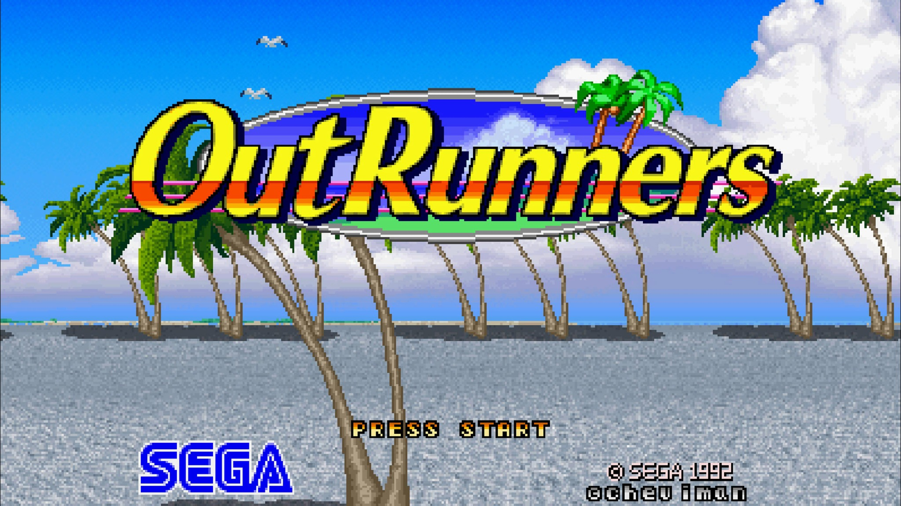
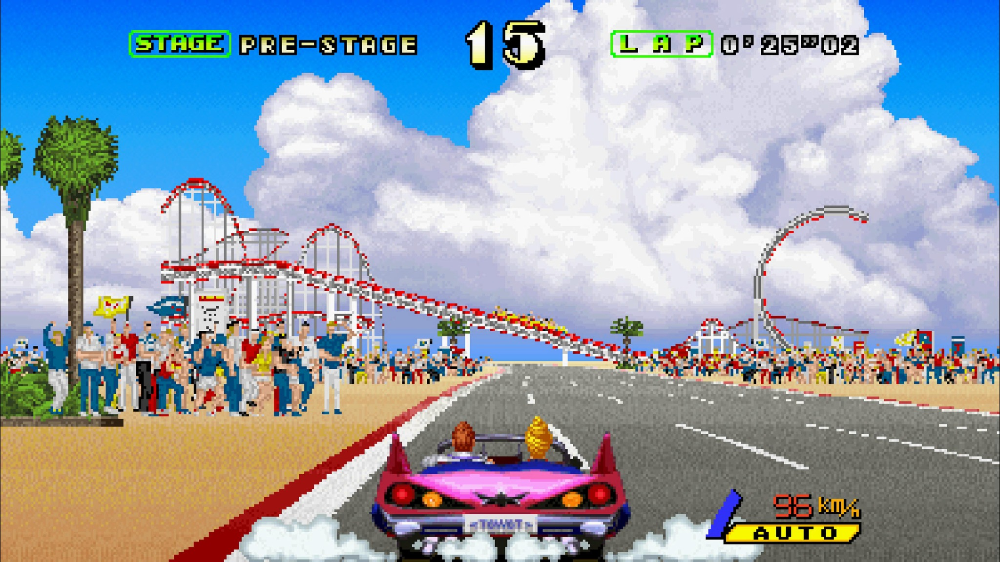

  

# OutRunners-PS5

A native PlayStation 5 homebrew port of Sega's
1993 arcade racing game, OutRunners.

Based on the OutRunners decompilation and native port
by Sebastian Toyos and its contributors, adapted for
the PlayStation 5 homebrew environment.

## Current version

**v1.0.0**

This release candidate has been tested on physical
PlayStation 5 hardware.

## Screenshots

## Features

- Native PS5 application
- Launch from the PS5 dashboard using a compatible
  native homebrew mounting environment
- Optimized software rendering and framebuffer output
- DualSense controller support
- Game audio and music
- Local two-player gameplay
- Pause and resume
- In-game options and settings
- FPS display option
- Automatic on-console ROM extraction and asset preparation
- Persistent configuration settings
- Controller vibration support

## Requirements

- A PlayStation 5 configured for native homebrew
- A compatible native application mounting environment,
  such as ShadowMountPlus
- Your own legally obtained OutRunners World ROM set
  (MAME set name: orunners)

No game ROMs or extracted arcade assets are included.

## Installation

1. Download and extract the release archive.
2. Copy the `PPSA98538` folder into `/data/homebrew/`.
3. Place your own `orunners.zip` beside `eboot.bin`.
4. Mount and launch the application from the PS5 dashboard.
5. Allow automatic first-time game data preparation to finish.

See the [installation guide](INSTALLATION.md) and
[DualSense controls](CONTROLS.md) for full details.

## Building from source

The reference build environment is Ubuntu 24.04
under WSL2, using Clang 18 and pinned PS5
homebrew development dependencies.

See [BUILD.md](BUILD.md) for build instructions
and dependency information.

## Release status

v1.0.0 has passed on-console qualification for
startup, gameplay, audio, options navigation,
pause, FPS display, local two-player operation
and exit/relaunch.

Two independent clean builds on the reference
development host produced identical executables.

See [build verification](docs/BUILD-VERIFICATION.md).

## Credits

- Sebastian Toyos and contributors — OutRunners
  decompilation and upstream native port
- BlackBearReloaded — PS5 native application boilerplate
- PS5 Payload Dev contributors — public SDK and PacBrew
- SDL contributors — SDL2
- byuu and the higan team — libco
- GNU libiconv contributors
- Jean-loup Gailly and Mark Adler — zlib
- JJBurtenshaw — PS5 port integration and hardware testing

- ChatGPT -- ;)

## License

See [LICENSE](LICENSE) and the
[third-party notices](THIRD-PARTY-NOTICES.md).

Individual upstream components retain their
respective copyright and license terms.

OutRunners and associated game assets belong to
their respective rights holders.

This is an unofficial homebrew project. It is not
affiliated with, endorsed by, or supported by Sega
or Sony Interactive Entertainment.

See [artwork provenance](docs/ARTWORK.md).

## Related Projects

[CannonBall-PS5](https://github.com/JJBurtenshaw/CannonBall-PS5)
— a complementary native PlayStation 5 homebrew port of
CannonBall, the enhanced OutRun engine.

Both projects bring classic Sega arcade racing games to
native PS5 homebrew.
